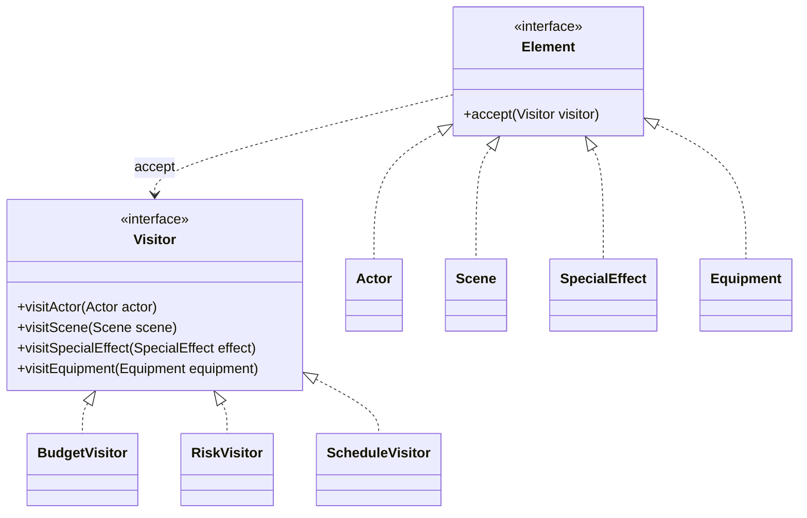

# Movie Production Analyzer — Visitor Pattern

**Course:** Software Design Patterns  
**Assignment:** #6 — Visitor Pattern  
**Language:** Java

## 1. Project Description

Movie Production Analyzer is a small Java program that analyzes parts of a movie production.

The program has different production elements:
- Actors
- Scenes
- Special effects
- Equipment

It uses the **Visitor design pattern** to run different operations on these elements without changing their classes.

The program creates three reports:
1. **Budget Report** — calculates production costs.
2. **Risk Report** — estimates risk points.
3. **Schedule Report** — estimates the number of days.

## 2. Project Structure

```text
MovieProductionAnalyzer/
├── src/
│   ├── Element.java
│   ├── Visitor.java
│   ├── Actor.java
│   ├── Scene.java
│   ├── SpecialEffect.java
│   ├── Equipment.java
│   ├── BudgetVisitor.java
│   ├── RiskVisitor.java
│   ├── ScheduleVisitor.java
│   └── Main.java
└── README.md
```

## 3. UML Class Diagram



## 4. How Visitor Works

The `Element` interface declares the `accept(Visitor visitor)` method.

Every concrete element implements this method. For example:

```java
@Override
public void accept(Visitor visitor) {
    visitor.visitActor(this);
}
```

This is called **double dispatch**.

First, Java calls the `accept()` method of the concrete element. Then the element calls the matching visitor method. The visitor can run the correct operation for that element.

The `Visitor` interface declares one method for every element type. Each concrete visitor implements all these methods.

## 5. Clean Code Principles

### 1. Meaningful Names
Class and method names explain their purpose. For example, `BudgetVisitor` calculates costs and `visitActor()` works with an actor.

### 2. No Type Checking
The program does not use `instanceof` or long `if/else` chains to identify element types. The `accept()` method and double dispatch select the correct visitor method.

### 3. Single Responsibility Principle
Each visitor has one main responsibility:
- `BudgetVisitor` calculates costs.
- `RiskVisitor` estimates risks.
- `ScheduleVisitor` estimates time.

### 4. Encapsulation
Element fields are private. Visitors read the required information through public getter methods. This protects the internal data of the elements.

### 5. Open/Closed Principle
A new operation can be added by creating another visitor, such as `MarketingVisitor`. The existing element classes do not need to change. A new element type would require updating the Visitor interface and its implementations.

## 6. How to Run

You need Java 8 or newer.

Open a terminal in the project folder and run:

```bash
javac src/*.java
java -cp src Main
```

## 7. Example Output

The program prints three reports:
- The cost of every production item and the total budget.
- The risk level of every item and total risk points.
- The estimated days for every item and total estimated days.

The values are example data for demonstration. The schedule total is a simple sum of item durations, not a real parallel production calendar.

## 8. Conclusion

The Visitor pattern makes it possible to add new operations to a stable group of objects. In this project, the same production elements are analyzed by three different visitors. The element classes stay focused on their own data, while visitors contain the analysis logic.
